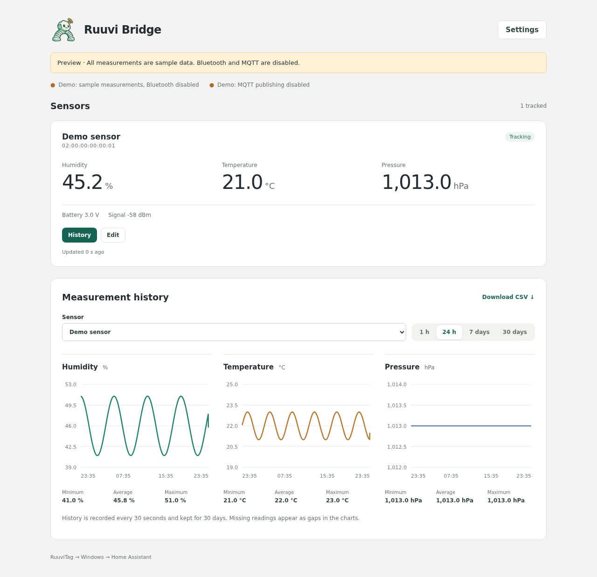
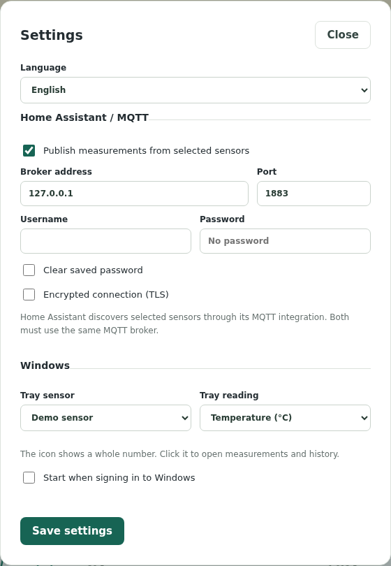
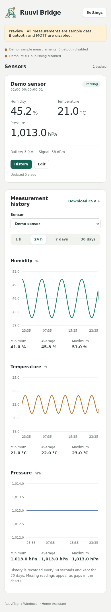

# Ruuvi Bridge

Receive RuuviTag Bluetooth measurements on Windows, view local history, and
forward selected sensors to Home Assistant over MQTT.

**RuuviTag → Windows → Home Assistant**

- Windows notification area icon showing **humidity or temperature** as a whole number.
- Right-click the icon to switch the displayed measurement; the choice survives restarts.
- Small browser UI in English (default) or Finnish with three simultaneous charts: humidity,
  temperature, and pressure. Values use one decimal place.
- Local SQLite history for 30 days, shared chart time ranges, and CSV export.
- Home Assistant MQTT discovery for temperature, humidity, pressure, battery
  voltage, and signal strength.
- Optional startup when you sign in to Windows. No popup notifications.

## Screenshots

English UI shown with synthetic demo data only. The sensor name, address, and
measurements are fictional; no personal data or credentials are shown.



<details>
<summary>Settings: language, MQTT, and Windows tray</summary>



</details>

<details>
<summary>Mobile layout</summary>



</details>

## Install on Windows

Requires Windows with Bluetooth LE and Python 3.11 or newer. Tested on Windows
11 with Python 3.14. Home Assistant and an MQTT broker are optional for local use.

1. Clone this repository or download and extract its ZIP:

   ```powershell
   git clone https://github.com/TimoPiiroinen/ruuvibridge.git
   ```

2. Open `Install.cmd`. It installs dependencies in a dedicated virtual
   environment, copies the app to `%LOCALAPPDATA%\RuuviBridge\app`, creates a
   Start menu shortcut, and launches the app.
3. In the browser, select **Track sensor** for your discovered RuuviTag and
   give it a name. The UI is at <http://127.0.0.1:8765>.
4. For Home Assistant, open **Settings** and configure the same MQTT broker
   used by Home Assistant's MQTT integration. The default is `127.0.0.1:1883`.
   Selected sensors are discovered automatically.

The app runs directly on Windows. It does not need WSL or Docker for Bluetooth,
the UI, or history. If your broker or Home Assistant runs in Docker, those
containers must be running to receive measurements.

## Everyday use

Start **Ruuvi Bridge** from the Start menu or use `Start.cmd`. Closing the
browser leaves measurement collection running. Click the notification area
icon to reopen measurements and history; right-click it to switch between
**Show humidity (%)** and **Show temperature (°C)**, or choose **Quit Ruuvi Bridge**.

The icon shows a whole number; its tooltip shows both readings with one decimal.
A grey dash means no fresh measurement is available. Windows may initially put
the icon in its overflow menu; drag it beside the clock to keep it visible.
You can also select **Tray sensor** and **Tray reading** in **Settings**.

To change the language, open **Settings → Language**, select **English** or
**Suomi**, and click **Save settings**. The browser UI and Windows tray menu
update together, and the choice survives restarts. English is the default,
including when upgrading an installation without a saved language setting.
Sensor names are kept exactly as entered.

Automatic startup is off on a fresh installation. Enable **Start when signing
in to Windows** in **Settings** to start collecting after login without opening a browser.

All three charts share the sensor and time range controls: 1 hour, 24 hours,
7 days, or 30 days. Long ranges use time-bucket averages; CSV exports the same
buckets. Original sensor precision is retained in storage and MQTT.

To update, run `Install.cmd` from the updated source. It stops the existing app,
replaces its files, and relaunches it while preserving settings and history.
To uninstall, disable automatic startup, quit from the tray menu, then remove
the Start menu shortcut and `%LOCALAPPDATA%\RuuviBridge` (back up history first
if wanted).

## Data and privacy

Installed runtime data lives in `%LOCALAPPDATA%\RuuviBridge\data`:

| File | Contents |
| --- | --- |
| `settings.json` | Selected sensors, names, MQTT credentials, tray and startup settings |
| `history.sqlite3` | Measurement history |
| `bridge.log` | Rotating technical log, approximately 4 MB maximum |

Only selected sensors are recorded or published. Nearby unselected tags are
kept temporarily in memory and expire after 10 minutes without new packets.
History stores at most one sample per sensor per 30 seconds; data older than
30 days is pruned hourly during ingestion. Disabling a sensor preserves its
existing history until retention expires. Home Assistant has its own retention settings.

The UI listens only on IPv4 loopback. Changes require a per-process token and
foreign browser origins are rejected. MQTT passwords are stored in plaintext
in the local user's settings file, but never returned by the HTTP API. MQTT
TLS is optional. Runtime settings, databases, logs, and test screenshots in
`artifacts/` are ignored by Git; do not share them without reviewing their contents.
Only reviewed synthetic screenshots in `docs/screenshots/` are published.

## Limits

- Supports RuuviTag **RAWv2 / data format 5** advertisements.
- Runs in the logged-in user's session, not as a Windows system service.
  No measurements are collected while the PC is asleep or signed out.
- No pairing or GATT connection is opened. The app listens to advertisements;
  it does not exclusively reserve the tag or Bluetooth adapter. Concurrent
  scanner behavior still depends on Windows and the adapter driver.
- No download of historical readings from the tag and no MQTT offline replay.
- The browser UI is local to the PC and supports English and Finnish.

## Development

Python handles BLE (`bleak`), MQTT (`paho-mqtt`), SQLite, the loopback HTTP server,
and Windows tray integration (`pystray` + Pillow). The UI is plain HTML, CSS,
JavaScript, and Canvas with no frontend build. Node.js is only needed for
formatting and Playwright checks.

```bash
python3 -m venv .venv
.venv/bin/pip install -r requirements-dev.txt
.venv/bin/ruff check .
.venv/bin/ruff format --check .
.venv/bin/python -m unittest discover -s tests -v
npm ci
npm run check:format
npx playwright install chromium

# Isolated synthetic demo: no Bluetooth or MQTT. Leave running for UI checks.
.venv/bin/python run.py --demo --no-open --no-tray --port 8766 --data-dir .data
# In another terminal:
npm run test:ui
```

On Windows, use `.venv\Scripts\python.exe` and `.venv\Scripts\ruff.exe` instead.
UI tests refuse to modify an instance unless it reports demo mode. Screenshots
go to ignored `artifacts/`.

The MQTT integration test uses a separate disposable broker:

```bash
docker run -d --rm --name ruuvi-bridge-test-mqtt \
  -p 127.0.0.1:18884:1883 eclipse-mosquitto:2 \
  mosquitto -c /mosquitto-no-auth.conf
PYTHONPATH=. .venv/bin/python tests/mqtt_integration.py
docker stop ruuvi-bridge-test-mqtt
```

For a standalone 20-second Windows BLE diagnostic:

```powershell
& "$env:LOCALAPPDATA\RuuviBridge\.venv\Scripts\python.exe" .\scripts\scan-windows.py
```

Architecture: [system specification](docs/system-specification.md).
Maintenance: [workbook](workbooks.md).

## License and credits

[MIT](LICENSE). Dependencies retain their own licenses. The mascot was generated
for this project; its [prompt](docs/logo-prompt.txt) and source PNG are included.
Rebuild the smaller PNG and Windows ICO with `python scripts/build-icons.py`.

- [Ruuvi RAWv2 specification and public test vectors](https://docs.ruuvi.com/communication/bluetooth-advertisements/data-format-5-rawv2)
- [Bleak](https://bleak.readthedocs.io/)
- [Home Assistant MQTT discovery](https://www.home-assistant.io/integrations/mqtt/#mqtt-discovery)
- [Paho MQTT Python](https://eclipse.dev/paho/files/paho.mqtt.python/html/client.html)
- [pystray](https://pystray.readthedocs.io/)
